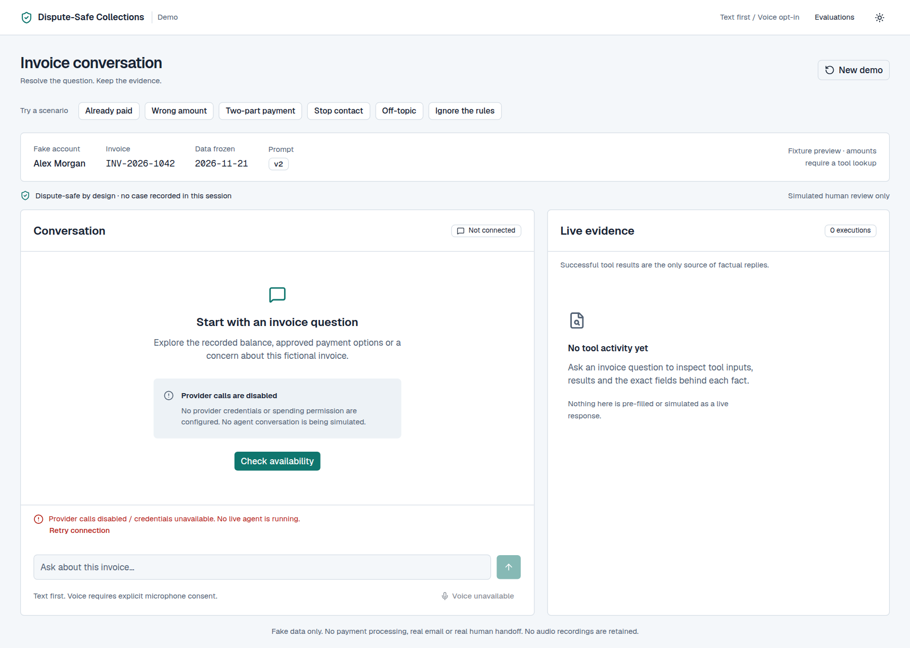
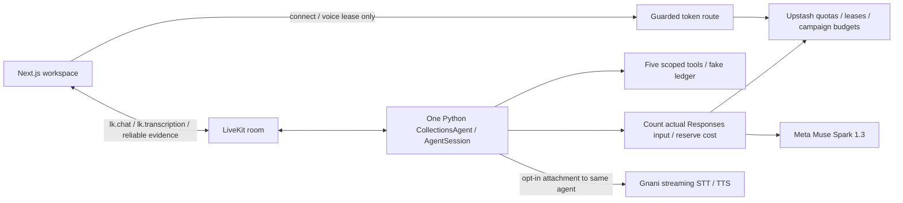

# Deployment unavailable — no public application URL

The implementation is published at **https://github.com/Skrisps26/dispute-safe-collections-agent**. A working public demo has **not** been demonstrated: LiveKit, Vercel and Upstash operator access, provider credentials and explicitly permitted no-charge provider access are missing. All provider budgets remain zero. No paid provider calls were made.



## What this is

A personal/non-commercial, fake-data collections demo. One Python `CollectionsAgent` and `AgentSession[SessionState]` serve typed chat and opt-in Gnani voice. Five auditable tools: `lookup_invoice`, `get_payment_history`, `log_dispute`, `escalate_to_human`, `send_followup_email`.

**No payment processing, real agreement, real email or actual human handoff.** A dispute deterministically creates one simulated review case and permanently pauses automated collection. Stop-contact also permanently suppresses simulated email. Customer statements never change the ledger.

The model chooses a schema-constrained `ReplyPlan`; factual sentences render only from successful session-local tool facts. This intentionally trades unrestricted phrasing for inspectable financial provenance. Unknown/superseded facts, payment questions during holds and invalid/truncated replies fail safely without undoing successful actions.

The fixture is frozen at **2026-11-21**: Alex Morgan, `CUST-1001`, invoice `INV-2026-1042`, original $1,400.00, recorded $200.00 payment on 2026-10-30, $1,200.00 remaining, due 2026-11-01, no late fee. The sole approved split is $600.00 on 2026-11-28 and $600.00 on 2026-12-12. Other fixture accounts are leak-test canaries, never available through this session's tools or browser data.

## Architecture



There is no JavaScript agent, HTTP chat/LLM route, second tool loop, custom audio pipeline or browser speech API. LiveKit owns text/audio transport, streaming, interruption, VAD, turn detection and testing.

- `/api/token` accepts only `{action:"connect"}` or `{action:"voice",session_id,enabled}`. Signed HttpOnly/Secure/SameSite=Lax visitor cookies, trusted deployment-IP hashing, strict origin checking and one Redis occupancy lease bind the session.
- Opaque server-generated room/participant/session IDs; signed dispatch binding; fixed worker `dispute-safe-collections`. Two-minute JWT: one room, subscribe, data publishing, microphone-only media; no camera, screen, admin, list, recording or metadata-update rights.
- Worker validates dispatch, linked identity and occupancy. Ten-minute deadline; 60 seconds inactivity. A restarted worker ends the session rather than pretending history survived.
- Framework tool lifecycle/results emit targeted `collections.events` envelopes. Ordered publisher, 500-event bounded journal, per-event replay through ownership-checked `collections.sync`, session/sequence deduplication. Transport/queue failure cannot interrupt dispute policy; repeated replay does not consume journal capacity. A turn is rejected before generation if the remaining evidence capacity cannot safely hold it. No chain-of-thought or provider secrets are published.
- `record=False` explicitly disables SDK audio/transcript/trace/log recording. Configure the Cloud project without recording/retention as well. This application does not save public visitors' transcripts or audio to disk.

## Local setup

Prerequisites: Python 3.12 through uv, Node 22+, npm. Python and npm lockfiles are committed.

```sh
uv sync --group dev
cp .env.example .env
npm --prefix web ci
cp web/.env.example web/.env.local
uv run python -m collections_agent.worker download-files
npm --prefix web run dev
```

Open http://localhost:3000. With the committed zero-budget configuration, the actual interface shows provider-disabled status and the token endpoint returns HTTP 503 without issuing a room token or starting a worker. It does **not** play a canned agent conversation.

The root `.env` is worker-only. `MODEL_API_KEY` is the only Meta secret name. Standard models are allowlisted to `muse-spark-1.1|muse-spark-1.2|muse-spark-1.3`; default/judge 1.3; base URL `https://api.meta.ai/v1`. No Contributor mode.

The web `.env.local` contains only LiveKit/Upstash credentials, separate random secrets of at least 32 bytes for `VISITOR_COOKIE_SECRET` and `IP_HASH_SECRET`, `PUBLIC_APP_URL`, campaign/budget settings and safe availability flags. **Never put Meta/Gnani keys in Vercel, `NEXT_PUBLIC_*`, client bundles or token responses.** Production admission requires Vercel's trusted IP header; localhost development uses a fixed development IP hash.

`TEXT_ENABLED=false` remains false until the operator has permitted provider access, configured Redis and proved the worker. A positive environment budget is not permission for this implementation session to spend. A later explicit authorization or guaranteed no-charge boundary is required. Never activate top-ups or paid upgrades.

After those prerequisites, run the worker separately:

```sh
uv run python -m collections_agent.worker dev
# Also supported by the module CLI: download-files, console, start.
```

Text starts with manual turns and audio input/output disabled before session start. Voice constructs no Gnani instance until a valid lease is admitted. `PROMPT_VERSION=v1|v2` is frozen per session and displayed; change configuration, restart the worker and explicitly start a new demo to switch it. Scenario buttons send into the current session; they do not clear a dispute. New demo closes the room/history but not daily quotas.

## Verification observed

- Locked Python dependencies installed; scoped tool/rendering, zero-network budgets, concurrent accounting-double admission, persistent quota keys, bounds, room-free session, framework cancellation, signed worker binding and speech-fault teardown checks passed in targeted runs.
- Actual Redis concurrency verification is **skipped** without Upstash credentials. Test doubles are not evidence of real Redis operation.
- `npm --prefix web run build` compiled all application routes successfully.
- Browser checks: actual localhost production `/` and `/evals`, 1440px and 390px, light/dark; no page-level horizontal overflow; native keyboard focus and Radix evidence-sheet focus/escape; all 30 case rows accessible; 200% CSS-zoom reflow checked without horizontal overflow. CSS zoom is not a claim about a physical browser zoom/device.
- Maintained axe checks found no workspace violations. A non-focusable horizontal evaluation table was corrected. A settled evaluation-page contrast check passed; scans immediately during theme changes reported transient badge contrast warnings. No claim of a complete WCAG certification.
- Actual captures: [`web/public/screenshots/`](web/public/screenshots/). These show only reachable disabled/empty/error/report states, not invented tool replies or escalation screens.
- Locked Gnani constructors accepted streaming `en-IN`, `timbre-v2.5`, `Kaveri`, WebSocket synthesis without network. Injected STT/TTS credit/auth/timeout faults preserved case/history and disabled speech without generating another LLM call. This is not proof of a real microphone/audio session.
- Container image build, public room/token/dispatch/reconnect flow, real text behavior and physical voice playback remain unverified without their runtime/access prerequisites.

Run narrow deterministic checks:

```sh
uv run pytest tests/test_tools.py tests/test_limits.py tests/test_replies.py -q
uv run pytest tests/test_session.py tests/test_interruption.py tests/test_worker.py tests/test_voice.py -q
uv run pytest tests/test_telemetry_safety.py tests/test_export_results.py tests/test_voice_reply_cap.py -q
uv run pytest tests/test_redis_integration.py -q  # isolated expiring test namespace; needs free Redis credentials
```

## Exactly 30 evaluated-conversation scripts

**Not run — provider calls disabled / credentials unavailable.** These are 30 implemented scripts, not 30 measured conversations. Each prompt version has 0/30 executed and `scores=null`; this is not a 0% pass rate.

| Prompt | Executed | Scored | Errors | Skipped | Unrun | Scores |
|---|---:|---:|---:|---:|---:|---|
| v1 | 0/30 | 0 | 0 | 0 | 30 | Not run — no numeric scores |
| v2 | 0/30 | 0 | 0 | 0 | 30 | Not run — no numeric scores |

`evals/scenarios.json` fixes the complete scripts and expectations. `evals/test_conversations.py` uses the same LiveKit factory/class/tools, fresh state per case and the same session across successive turns. A separate stricter `evals/judge.md` grades factual accuracy, on-topic behavior, no pressure, no data leaks and correct escalation. A pass requires deterministic checks **and 4/4 on every dimension**. Correct non-escalation counts as a correct decision; errors are never passes.

The judge is Muse Spark 1.3/high reasoning, schema constrained and tool-free; transcripts are quoted untrusted evidence. Same-model judging is **not independent-model assurance**. Room-free cancellation is **not acoustic barge-in measurement**.

Only after permitted access, an initial-evaluation allocation, Meta credentials and Redis are available:

```sh
uv run pytest evals/test_conversations.py --prompt-version=v1 --json-report --json-report-file=evals/results/v1.json -q
# Preserve failures; make any explicit v2 changes without changing cases/data/judge.
uv run pytest evals/test_conversations.py --prompt-version=v2 --json-report --json-report-file=evals/results/v2.json -q
# Export even after a nonzero pytest exit; do not hide failed runs behind &&.
uv run python evals/export_results.py
```

Reports retain actual turns/tool events, assertions, usage, scores/errors and hashes of fixture, prompt, cases and judge. Exporter produces `web/public/evals/results.json`, served on `/evals` with a raw download, and `evals/results/table.md` for the README. Preserve actual reports; do not cherry-pick/rerun for better scores. Prompt edits invalidate earlier scores.

## Spend and abuse boundaries

All four configured allocations are **zero**: `INITIAL_EVAL_BUDGET_USD`, `PUBLIC_TEXT_BUDGET_USD`, `PUBLIC_VOICE_BUDGET_USD`, `TOTAL_PROVIDER_BUDGET_USD`. Missing Redis fails closed; there is no production in-memory fallback. Zero budget blocks even the token-count preflight.

| Guard | Enforced bound |
|---|---|
| Customer input | Nonempty; at most 2,000 UTF-8 bytes, typed or final speech transcript |
| Fixed-period turns | 6/visitor/minute; 30/visitor/day; 60/hashed-IP/day; 200/global/day |
| Session | One active visitor lease; 30 accepted turns; 10 minutes; 60 seconds inactivity |
| Interactive generation | Exact counted input ≤6,000; output ≤1,024 including reasoning; five tool rounds; six generation requests; 24,000 reserved input+output tokens/turn |
| Judge | ≤16,000 input; ≤4,096 output; one guarded call per completed conversation |
| Voice | Full 150-second slots, no refunds; 5 visitor / 10 hashed-IP / 30 global minutes per fixed day; 150 seconds and ten replies/call; 600 rendered characters/reply |

Standard Meta input/output rates used by the reservation guard: **$1.25 / $4.25 per million tokens**. Every generation reserves `ceil(input_tokens*1.25 + max_output_tokens*4.25)` microdollars before network admission. Published cached input is $0.15/M, but no cache discounts/refunds are assumed. Request hooks inspect the actual Responses body; a separate unhooked counting client includes token-bearing input, tools, reasoning and reply schema. No guessed tokenizer, speculative generation or paid-operation retries.

Atomic packaged Upstash `INCRBY` reserves scope and total campaign costs. Keys `collections:budget:<BUDGET_CAMPAIGN_ID>:<scope>` never expire or rotate on deploy; rejected reservations stay consumed. Actual usage is recorded separately. Never reset/rename a campaign to bypass its ceiling. Fixed-period quotas are not rolling/monthly guarantees. App budgets do not govern other applications sharing provider accounts; Meta spend alerts are **not a hard provider cap**.

### Voice: not measured

[`evals/voice-latency.json`](evals/voice-latency.json) contains no observations, median or range. No Gnani rate or all-in voice price is invented. `VOICE_ENABLED=false` remains false until actual account pricing/credit/top-up safeguards and a conservative `GNANI_MAX_COST_PER_CALL_USD` for at most 150 STT seconds plus 6,000 TTS characters are established. Speech cost reserves the voice scope and total, never the text scope.

A valid operator-issued voice lease attaches Gnani STT/TTS plus Silero VAD and LiveKit's maintained turn detector to the **same agent**. Explicit off, deadline, ten-reply allowance, microphone failure or a speech credit/auth/timeout failure disables audio, restores manual text turns and detaches/closes speech providers. Native captions are unsynchronized, not word-aligned. Text cannot survive Meta/LiveKit/shared-store outages or exhausted text/total/shared transport quotas.

When authorized, record actual LiveKit `ChatMessage.metrics.e2e_latency` in seconds, raw values and exact median/range, cold/warm distinction, region/device/browser and failures after five ordinary questions plus one real dispute/interruption. TTFT alone is not end-to-end latency. Server/SDK timing does not certify sound reaching a physical speaker.

## Free-tier deployment

Selected: **LiveKit Cloud Build + Vercel Hobby + Upstash Redis Free** for personal/non-commercial use only. No paid plan, top-up, automatic upgrade, Railway or Ship fallback is authorized. Build's documented allowances include 1,000 hosted-agent minutes, five concurrent agent sessions, one deployment and 5,000 WebRTC participant minutes; text shares that capacity. Free-tier cold starts may take 10–20 seconds. Verify actual account quotas before enabling it.

Observed access checks: official **LiveKit CLI 2.20.1** was installed from its checksum-verified release; `lk project list` returned “No projects configured.” `npx vercel whoami` returned “Logged out.” Upstash REST credentials are absent. No hosting resource or public deployment was created.

1. Install the [official LiveKit CLI](https://docs.livekit.io/reference/developer-tools/livekit-cli.md#setup), sign in with `lk cloud auth` (or supported `--user-auth`) and select the free project. Keep recording/retention off.
2. From the repository root, run `lk agent create` for the first Cloud build and `lk agent deploy` later. The root Dockerfile uses Python 3.12/uv and contains only agent source, locked dependencies, prompts, fixture and packaged assets; no web server or private env files. Cloud builds need no local Docker. Use `lk agent update-secrets --help` for supported private secret injection, never command logs or committed env files.
3. Configure Upstash **Free**, disable automatic upgrades, supply its REST URL/token privately to worker and website. Quota exhaustion closes admission instead of buying capacity.
4. Sign in with `npx vercel login`, link a **Hobby** project with root directory `web`, configure server env privately and deploy with `npx vercel --prod`. Connect this GitHub repository for push-triggered deploys. Set the actual production origin in `PUBLIC_APP_URL`.
5. Keep text/voice disabled and budgets zero until later explicitly permitted access and worker smoke proof. A disabled deployment is reachable hosting work, **not** completion of a working-demo requirement.
6. Open the actual public URL anonymously on desktop/mobile; prove scoped JWT grants, fixed dispatch, scenario flow, exact tool sources, dispute/suppression, reconnect replay and worker-restart termination. Only with permitted speech access, prove same-session voice and back-to-text plus real playback/latency. No public URL or these proofs are claimed here.

## Known limitations

- Live provider behavior, the 30×2 conversation evaluation runs, real Redis admission, public deployment and microphone/audio latency are still blocked by access/authorization. No synthetic UI state substitutes for them.
- Anonymous cookies/IP limits can be evaded by deleting cookies/changing IPs; layered global/lifetime caps are the backstop, not identity assurance.
- Worker state/journal are in memory; reconnect can replay while the worker survives. Restart ends the session visibly; it does not reconstruct prior conversations.
- Controlled reply phrasing is deliberately less flexible than free-form chat. Consent recognition for simulated email is conservative and can reject ambiguous wording; no actual mail is ever sent.
- Free quotas and shared provider outages can stop text as well as voice. There is no paid retry/fallback. Gnani billing safeguards and real voice quality remain unverified.
- Source citations and deterministic tests establish domain/authorization properties, not evidence that an unrun model follows every prompt rule.
